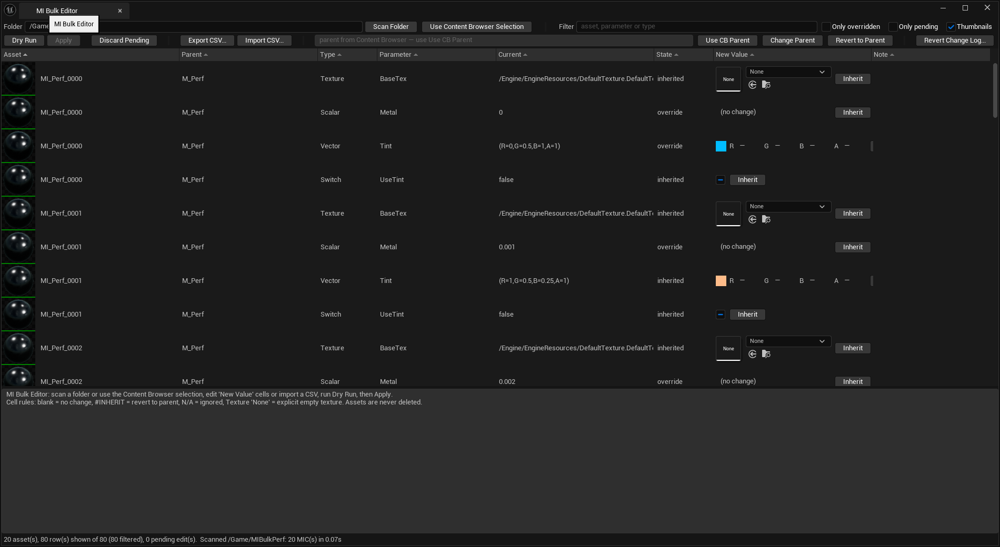
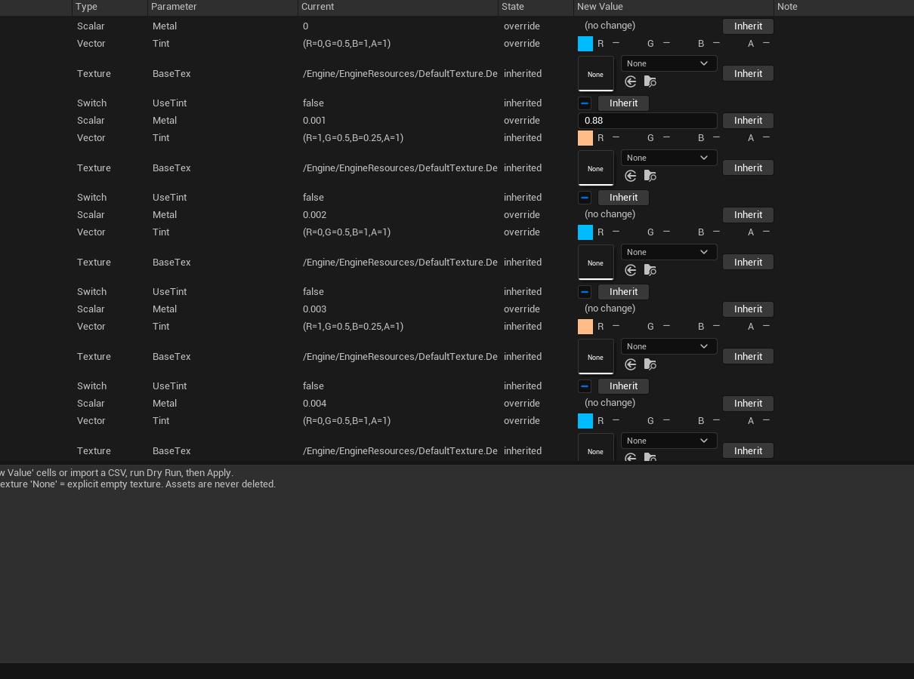
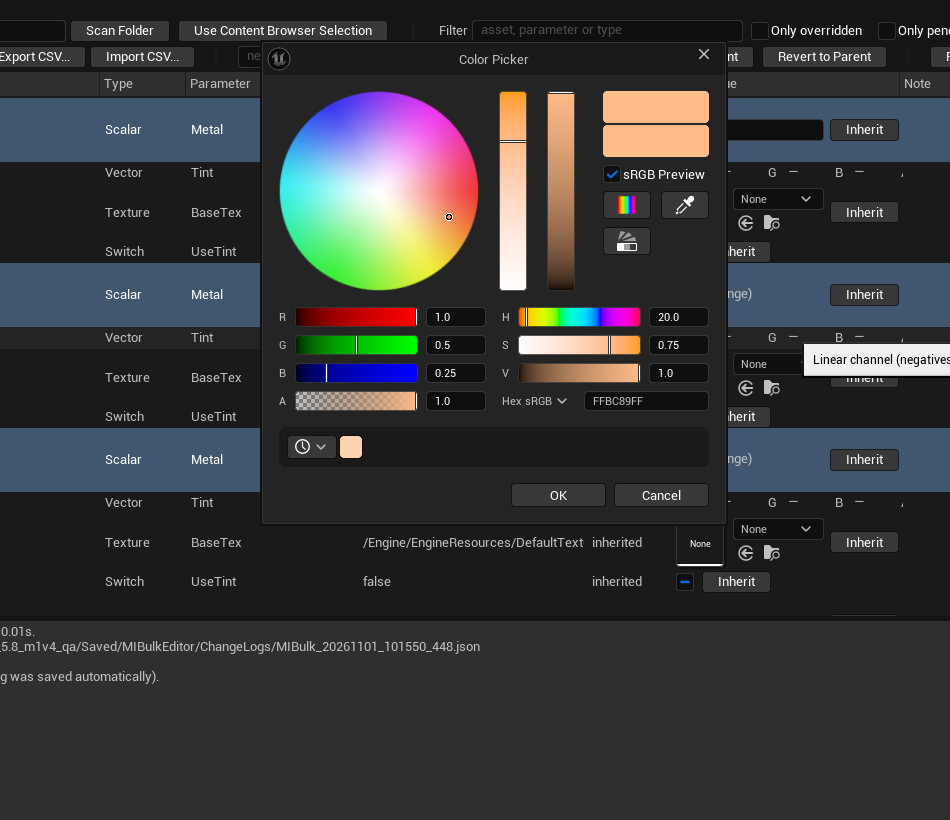
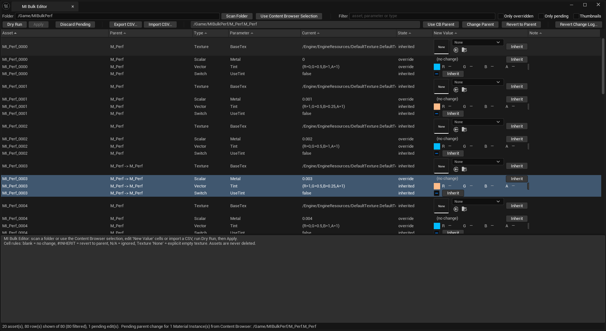
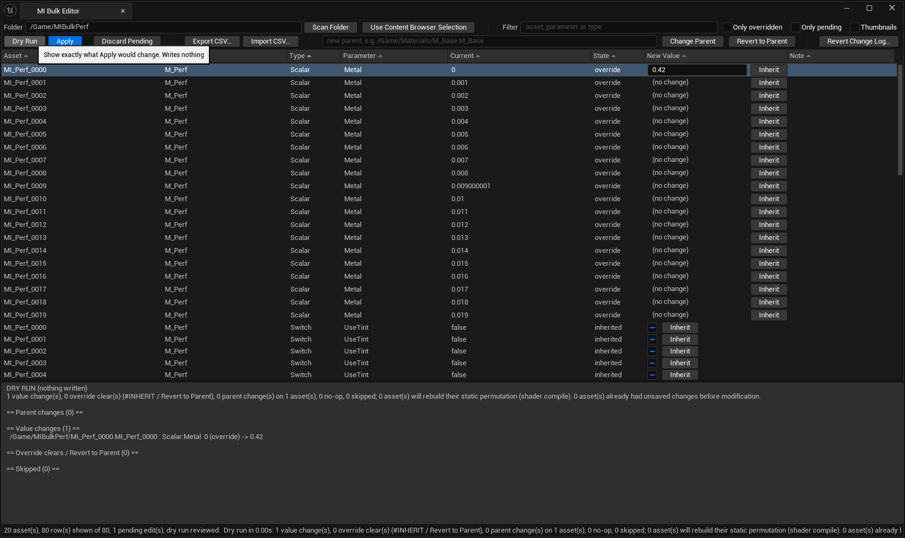
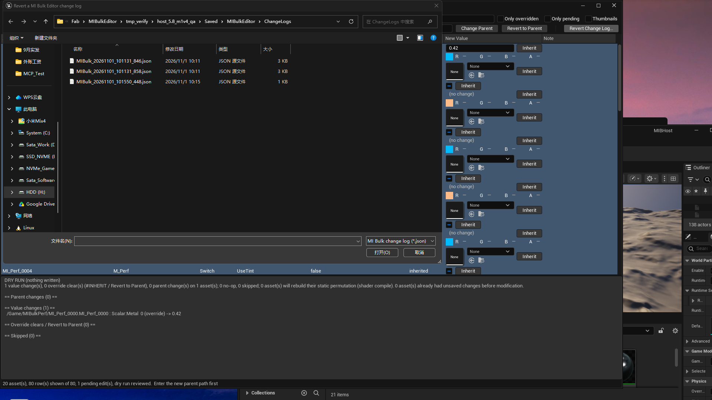

# MI Bulk Editor: User Guide
*Bulk editor for Material Instance Constants in Unreal Engine 5*
Publisher: Haishan · Author: Christon Chan · Version 1.0.0 · Supported engines: UE 5.0–5.8 · Platform: Win64 editor

MI Bulk Editor is an **editor-only** plugin. It edits Material Instance Constant assets in your project. It never auto-saves and it never deletes assets: changed Material Instances are only marked as modified, and you decide when to save them with **Save All**.

## 1. Opening MI Bulk Editor
There are three ways to open the **MI Bulk Editor** tab:
- **Tools > MI Bulk Editor**.
- In the Content Browser, select one or more Material Instances, right-click, and choose **Edit in MI Bulk Editor**. The table lists the selected Material Instances.
- In the Content Browser, right-click one or more folders and choose **Open Folder in MI Bulk Editor**. The table lists the Material Instances in those folders, including subfolders.

Inside the tab you can also load assets yourself:
- **Folder** + **Scan Folder**: type a package path (for example `/Game/Materials`) and scan it, including subfolders.
- **Use Content Browser Selection**: load the Material Instances currently selected in the Content Browser.

## 2. The table
Each row is one parameter of one Material Instance.

| Column | Meaning |
|---|---|
| Asset | The Material Instance (when **Thumbnails** is on: each parameter row shows its own 64 px preview) |
| Parent | Its current Parent material |
| Type | Scalar, Vector, Texture or Switch (Static Switch) |
| Parameter | Parameter name |
| Current | The value the Material Instance uses now |
| State | `override` (set on this Material Instance) or `inherited` (comes from the Parent) |
| New Value | Your pending edit, shown in an editor that matches the parameter type (see section 3). No pending edit means no change |
| Note | Warnings, for example for orphaned overrides |

Click a column header (**Asset**, **Parent**, **Type**, **Parameter**, **Current**, **State**, **New Value**, or **Note**) to sort the table. Click again to reverse the order. Every sortable header shows a sort arrow by default (the active column uses a stronger up/down arrow). Sorting only changes the display order: it does not clear pending edits, write assets, or create an editor undo step.

Use **Filter** (asset, parameter or type), **Only overridden** and **Only pending** to narrow the list.

**Preview thumbnails**
Click **Thumbnails** on the toolbar to show a small **64 px** preview on **every visible parameter row**. Click it again to hide them. There is **no** shared group thumbnail and **no** collapse / fold control — contiguous Asset order and scattered Parameter/Type order both show one preview per row.
- Thumbnails are **off by default**. When they are off, no previews are shown (and there are still no fold controls).
- The setting is remembered for your project when you close the tab or restart the editor. Each project has its own setting, so another project starts with thumbnails off.
- Only the rows you can see render a thumbnail. After **Apply**, **Ctrl+Z** / **Ctrl+Y** or a **Revert to Parent**, the thumbnails on the affected rows update. Dry Run and pending edits don't change thumbnails.
- Thumbnails don't change CSV export or import, Dry Run or undo.
- On very large lists (thousands of Material Instances), thumbnails can cost some scrolling performance. Turn them off if scrolling feels slow.
- A Material Instance whose Parent or texture is missing, or that fails to load, shows a **grey placeholder** with a **yellow warning icon**. Hover over it to see exactly **Asset missing or failed to load**.

**Supported parameters**
- Scalar, Vector, Texture and Static Switch parameters.
- Parameters exposed through Material Functions are included when they appear on the Material Instance (same table as the parent material's own parameters; not grouped separately).
- Global parameters only. **Layer parameters are not supported**: they can't be edited and are not exported to CSV.

**Orphaned overrides**
An orphaned override is an override stored on a Material Instance for a parameter that its Parent no longer has. It is shown as a **grey read-only row with a warning**. In version 1.0 it can't be edited or cleared, and the plugin leaves it as it is. When a Material Instance with orphaned Static Switch overrides has its static permutation rebuilt, the engine drops those Static Switch overrides; Dry Run warns you about this before you apply.

## 3. Editing values
The **New Value** column gives each parameter type its own editor. There is no free-text box: you pick, drag or tick the value, so a pending edit always has the right type.

Whatever editor you use, **only the pending edit changes**. Nothing is written to the asset, the asset is not marked as modified, and no editor undo step (**Edit > Undo History**) is created until you run **Dry Run** and **Apply**. Pending edits have their own undo inside the table; see *Undoing pending edits* below.

**Static Switch: checkbox**
Tick the box for `true`, clear it for `false`. Static Switch uses a **checkbox only** — there is no True/False dropdown. With keyboard focus on the box, **Space** toggles it.

**Vector: colour swatch**
The swatch shows the current colour. Next to the swatch, the cell also has **inline R, G, B, A** number fields (and an optional Hex field) for precise values, including negatives and values the Color Picker won't accept. Click the swatch to open Unreal's standard **Color Picker**:
- Set the colour with the colour wheel, the sliders or the numeric fields, including **Alpha**.
- Use the **eyedropper** in the Color Picker to pick a colour from a viewport, the Content Browser or anywhere on your screen. It is available on every supported engine version (UE 5.0–5.8); like elsewhere in Unreal, it is hidden in VR Mode.
- The swatch previews the colour while the picker is open. **OK** makes it your pending edit and adds one step to the table's edit history (see *Undoing pending edits* below). **Cancel**, or closing the picker window with its **X** button, puts back exactly the value you had before you opened the picker and leaves nothing behind: no pending edit and no history step.
- **Hex is always sRGB.** The **Hex** field shows and accepts sRGB colours (for example `#808080`). MI Bulk Editor stores colours as **linear** values, so a Hex entry is converted: `#808080` is stored as about `0.2159`. The linear numbers are what you see in the Dry Run report, in the change log and in an exported CSV file.
- **HDR colours (values above 1):** Hex can't represent values above 1. Enter HDR values in the picker's **R**, **G**, **B** numeric fields or with the brightness slider. They are kept as they are through Apply, undo and CSV export/import.
- The swatch can only display colours up to 1, so an HDR colour looks clipped in the swatch. That is only the display: the stored value is unchanged.
- **Negative values:** the Color Picker can't create negative values. A negative component that a colour already has is kept as long as you don't change that colour: opening the picker and pressing **Cancel**, closing it with **X**, or pressing **OK** without changing anything leaves it as it is. To set a negative component, type it into the **inline R, G, B, A** fields next to the swatch in the cell (not the Color Picker's own spin boxes, which can't go below 0), or write it in a CSV file; both give the same result. If you change a colour that has a negative component in the Color Picker, check the Dry Run before you apply.

**Scalar: number box**
Type a number and press **Enter**, or **drag** left/right on the box to adjust the value. While you drag, the table only previews the value; releasing the mouse makes one pending edit and adds one step to the table's edit history, however far you dragged. Press **Esc** to cancel what you are typing. The decimal point is always `.`.

Negative values are allowed, and typed values are never clamped. The slider range set on the material parameter only limits **dragging**: a drag stops at the ends of that range, but you can type any value, including one outside the range.

**Texture: asset picker**
- Open the drop-down to search for a texture and pick it, or **drag a texture from the Content Browser** onto the picker. Assets that aren't textures (materials, meshes and so on) are not accepted.
- Choose **None** (clear the picker) to set an override with no texture (a None texture override). This is not the same as going back to the Parent's texture.
- Click **Inherit** to the right of the picker to go back to the Parent's texture (see below).

**Inherit button (Scalar, Vector, Switch and Texture)**
Scalar, Vector, Static Switch and Texture cells have an **Inherit** button to the right of the editor (tooltip: *Restore inherited value (#INHERIT)*). It clears the override, so the value comes from the Parent again. It does exactly the same as writing `#INHERIT` in a CSV file and the same as **Revert to Parent**: the cell shows `#INHERIT` until you apply, and Dry Run lists it under **Override clears**. On a cell that already inherits, it changes nothing.

**Parent: asset picker**
The Parent has no **Inherit** button, because the Parent is not an override. See section 5.

| Pending edit | Result on Apply |
|---|---|
| A value from the editor | Sets an override with that value |
| (no pending edit) | No change |
| `#INHERIT` (from **Inherit** or **Revert to Parent**) | Clears the override, so the value comes from the Parent again |
| None (Texture only) | Sets an override with no texture (a None texture override). This is not the same as reverting to the Parent's texture |

Cells marked `N/A` (the Material Instance's Parent doesn't have that parameter) and read-only rows (orphaned overrides, layer parameters, engine or plugin content) show a disabled editor.

**Editing many Material Instances at once:** select the rows you want to change, then set the value in the New Value editor of **one of the selected rows**. Every selected row with the **same parameter name and the same type** gets the same pending edit.

If the selected rows don't all have the same value, the editor shows that instead of one value:
- Scalar number boxes and the Texture and Parent asset pickers show `Multiple Values`.
- A Static Switch checkbox shows the mixed (indeterminate) state.
- A Vector colour swatch shows diagonal stripes; hover over it to see `Multiple Values`.

Setting a value gives all of those rows the same pending edit. The status bar then tells you what happened, for example:
- `Edited 12 rows.`
- `Edited 1 row.`
- `Edited 12 rows. Skipped 3 (different parameter type).` when some selected rows have another parameter type.

Selected rows of another type or another parameter name, `N/A` cells, and read-only rows are skipped without an error. In 1.0 the status text still uses `Skipped M (different parameter type).` for all of those skip reasons. `Multiple Values` is based on each cell's **effective** value (including any pending edit), and every selected row that would be written shows it—not only the focused row. If you edit a row that is **not** part of the selection, only that row changes (`Edited 1 row.`) and the selected rows are left alone. You can also edit many Material Instances through a CSV file (see [CSV_FORMAT.md](CSV_FORMAT.md)); a CSV import fills the New Value editors with the imported edits so you can review or change them before Dry Run.

To forget edits, right-click and choose **Clear Pending Edit** for the selected cells, or click **Discard Pending** to drop all pending edits.

**Undoing pending edits**
Before you apply, pending edits have their own edit history in the table (in memory for the current window only). With keyboard focus on the table, **Ctrl+Z** undoes the last pending edit and **Ctrl+Y** redoes it.
Each of these adds **one** history step (a multi-row edit still counts as one step):
- Pressing **OK** in the Color Picker; releasing a Scalar or inline RGBA drag; typing a value and pressing **Enter**
- Toggling a Static Switch checkbox; picking or dragging a Texture or Parent; **Inherit**; **Revert to Parent**
- **Clear Pending Edit** / **Discard Pending**; importing a CSV (the whole import is one step)
- Pressing **Cancel** or closing the Color Picker with **X** adds no step; neither do Dry Run or Export CSV

If you set a control back to the cell's current effective value (for example toggle a Switch back to what it already is), the pending edit is cleared automatically—an inherited cell does **not** become an explicit override—but that click still adds one history step.

This history only changes pending edits. It never touches the assets and adds nothing to the editor's **Edit > Undo History**. It is cleared when you close the window, **Reload**, run a successful **Apply**, or **Revert All**.

After a successful **Apply**, the table history is empty: with focus on the table, **Ctrl+Z** is handed to the editor so you can undo that Apply as one transaction. You can also restore a batch later with **Revert Change Log...** (see section 8).

**Pending edits and CSV export:** **Export CSV** always exports the values the Material Instances have now (what has been applied), never pending edits that you haven't applied yet. If you export while pending edits exist, MI Bulk Editor tells you that they were not exported. Apply them first if you want them in the file.

**Compatibility notes (Scalar number box)**
- Dragging works on every supported engine version.
- UE 5.0–5.3: holding **Shift** or **Ctrl** while dragging doesn't change the drag speed (available from UE 5.4).
- UE 5.0: the mouse wheel doesn't step the value.
- UE 5.0 and 5.1: the number of decimal places shown can't be set, so the box may show fewer or more digits than on newer versions. The stored value keeps its full precision either way.

## 4. Revert to Parent
**Revert to Parent** clears overrides so the selected parameters inherit from the Parent again. It is available from:
- the **cell right-click** menu,
- the **row right-click** menu,
- the **Revert to Parent** toolbar button (works on the current selection, multi-select allowed).

Revert to Parent marks the selected overridden cells as `#INHERIT` (the same as the **Inherit** button and `#INHERIT` in a CSV file). After you apply, the New Value editor shows the inherited value again. Cells that are already inherited are not changed. Like any other edit, nothing is written until you run **Dry Run** and **Apply**, and the result can be undone with one **Ctrl+Z**. Orphaned overrides can't be reverted in 1.0.

## 5. Changing the Parent
Select the Material Instance rows you want to re-parent, then set a new Parent in either of these ways:
- **Use CB Parent** on the toolbar: select a **Material** or **Material Instance** in the Content Browser, then click **Use CB Parent**. Selected table rows get a pending Parent change (the Parent column shows `old -> new`). You do not type a path by hand.
- The **Parent** asset picker on a row (or **Change Parent** on the toolbar where shown): search in the drop-down, or drag a material or Material Instance from the Content Browser onto the picker.

Only materials and Material Instances are accepted. The Parent picker can't be cleared to **None**: every Material Instance needs a Parent, so there is no None or clear option (the same rule as the `Parent` column in a CSV file, where a blank cell means no change). There is no **Inherit** button on Parent. The picker and **Use CB Parent** both refuse the Material Instance itself or any parent that would create a loop. If the Content Browser has nothing selected, or the selection is the wrong type, **Use CB Parent** shows a clear message and does not change pending values. The change stays pending until Apply. You can also change Parents through the `Parent` column of a CSV file (see [CSV_FORMAT.md](CSV_FORMAT.md)).

Dry Run lists the overrides that the new Parent doesn't have, so you can see what would become orphaned before you commit.

## 6. Dry Run
Click **Dry Run** to see exactly what **Apply** would change. The values in the report are the same values the New Value editors show. Dry Run writes nothing: it does not modify assets and does not mark them as modified.

The report has these sections:
- **Parent changes**: old Parent → new Parent.
- **Value changes**: old value (override or inherited) → new value.
- **Override clears / Revert to Parent**: every cleared override is listed separately here, with a count.
- **Skipped**: edits that will not be applied, with the reason.
- **Warnings**: for example a value in a cell whose Parent doesn't have that parameter.

The summary also shows how many Material Instances will rebuild their static permutation (this triggers shader compilation).

**Apply** is available only after a Dry Run that contains changes. If you edit anything afterwards, run Dry Run again.

## 7. Apply
1. Click **Apply** and confirm.
2. If the assets changed since you reviewed the Dry Run, MI Bulk Editor shows the updated Dry Run instead and asks you to press **Apply** again.
3. All changes are applied as **one transaction**. Work in the New Value editors (dragging, picking colours and so on) adds no editor undo steps; before Apply it only uses the table's own history for pending edits (see *Undoing pending edits* in section 3). **One Ctrl+Z undoes the whole batch** (Ctrl+Y redoes it).
4. Every written value is read back and checked. The result report shows how many changes were verified and lists any failures.
5. A JSON change log is written (see section 8).
6. Changed Material Instances are marked as modified. **Nothing is saved automatically: use Save All yourself** when you are happy with the result.

**Static Switches:** when a Static Switch changes, the plugin rebuilds the Material Instance's static permutation so the switch really takes effect. The editor compiles the new shaders on demand, so compilation may start when the material is next rendered or when you save.

## 8. Undo and change logs
**Editor undo:** each Apply (including a revert from a log) is one editor transaction. Press **Ctrl+Z** once to undo the whole batch; the New Value editors and the table show the restored values.

**Table undo (before Apply):** pending edits that you haven't applied yet aren't in the editor's undo history. Undo and redo them in the table instead (**Ctrl+Z** / **Ctrl+Y** with focus on the table; see section 3).

**JSON change log:** every Apply writes a change log to:

`<Project>/Saved/MIBulkEditor/ChangeLogs/`

Each log records, for every change, the asset, the parameter, the value and override state before and after, and whether the change was verified.

**Restoring from a log**
1. Click **Revert Change Log...** and choose a `.json` file from the ChangeLogs folder.
2. MI Bulk Editor prepares the edits that restore the logged "before" state and shows them as a Dry Run. Parameters that were inherited before go back to inherited (the override is cleared; no override with the same value is created). Parents are restored too. Only changes that were verified when they were applied are restored.
3. Review the Dry Run and click **Apply**. The restore is itself one transaction (one Ctrl+Z undoes it) and writes its own change log.

You can restore from a log after restarting the editor (the logs live on disk under your project's `Saved` folder).

## 9. Known limitations
- Only Material Instance Constants (Material Instance assets) are edited.
- Global parameters only. Layer parameters are not supported.
- Orphaned overrides are read-only in 1.0 and can't be cleared.
- The plugin never saves and never deletes assets. Keep your project under source control or make a backup before large batch edits.
- Read-only or source-control-locked files are skipped with a warning (no automatic checkout). Real Perforce workflows have not been re-verified in QA — treat SCC skip as best-effort, not a Perforce guarantee.

## 10. Support
- Fab listing: <!-- Fab listing URL after publish -->
- Support: [chanjc03@gmail.com](mailto:chanjc03@gmail.com)
- CSV reference: [CSV_FORMAT.md](CSV_FORMAT.md) · FAQ: [FAQ.md](FAQ.md)

---

*Screenshots: store gallery 01/02/05/06/08/09. **01 / 05** reshot 2026-11-01 ~18:43 Asia/Shanghai from `host_5.8_thumb_group` DLL 18:13 (per-row thumbs, no fold; Use CB Parent + Parent read-only). 02 from `host_5.8_d1b`; 08 from `host_5.8_d1` (multi-select).*
